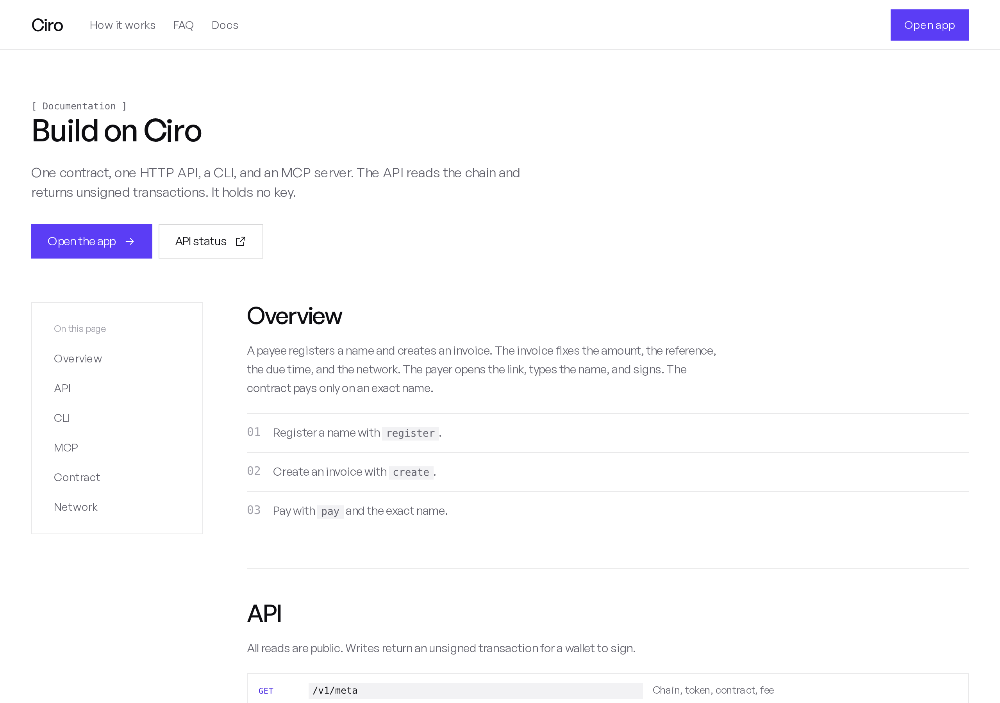
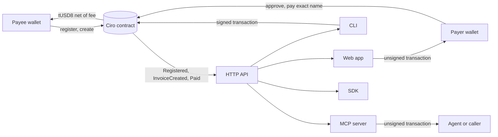

<div align="center">


# Ciro

**A stablecoin invoice that will not pay the wrong name.**

The amount is locked by the invoice. The payer's only decision is the name they were told.
The contract settles only when that name matches the name registered when the invoice was created.
A close name or an unknown name shows no pay button and moves no funds.

[ciro-a9s.pages.dev](https://ciro-a9s.pages.dev) · [GitHub](https://github.com/solutiono1/ciro)

Live on QDay Aevum testnet (chain 44005) · Ciro `0x4AceB37ecAce160B4363111460020c2d088C529C` · Fee 0 · [Source verified](https://explorer-test.qday.info/address/0x4AceB37ecAce160B4363111460020c2d088C529C?tab=contract)

</div>

---

## Demo

[Watch the 1:51.6 narrated walkthrough](https://ciro-a9s.pages.dev/media/ciro-demo-final.mp4). The landing loops the backed app-flow cut, muted.

Try the open demo: [ciro-a9s.pages.dev/#/demo](https://ciro-a9s.pages.dev/#/demo). The link follows the newest open 0.2 tUSD8 demo invoice.

The screenshots are from the live Aevum deployment (chain 44005). The transactions in the proof table are from it.

## Aevum Builder Challenge

Ciro is built for the Aevum Builder Challenge #1 in **Invoice Payments** and **Confirmation of Payee**. The submission copy, judge test script, and checklist are in [docs/submission/DORAHACKS.md](docs/submission/DORAHACKS.md).

If you invoice in stablecoins and want a testnet pilot, open a [pilot request](https://github.com/solutiono1/ciro/issues/new?template=pilot.yml). The go-to-market and pilot plan is in [docs/growth/GTM.md](docs/growth/GTM.md). No design partners or real volume yet; the plan is the next step.

---

## The idea

A stablecoin transfer carries a sender, a receiver, and an amount. It does not carry the invoice, it does not check the name the payer was given, and it leaves no receipt an accountant can file. When the amount is short, the name is wrong, or the payment is late, a person repairs it by hand. The transfer is final.

Ciro makes the name the check. The payee registers a name and creates an invoice with a locked amount, a reference, a due time, and a network. The payer opens the link and types the name they were told. The contract compares the folded name to the snapshot on the invoice. Exact settles. Close and unknown do not.

The chain is the record. The API reads it and prepares unsigned transactions. Only the payer's wallet signs, or the CLI with a local key. Ciro never holds a key and never holds funds.

## How it works

1. **Register a name.** The payee publishes the name they want to be paid under. It is folded, so capitals and extra spaces still match.
2. **Create an invoice.** Amount, reference, and due time. The name, amount, due time, and network are locked on the invoice.
3. **Pay the name.** The payer opens the link, types the name, and signs. The contract settles only on an exact match.
4. **Keep the receipt.** Amount, payer, payee name, network, transaction hash, and time. The screenshot an accountant gets.

## Why a name

A wallet address is easy to copy wrong and hard to check. A registered name is something two people can agree on out loud. Ciro treats the name as the check, not as a label.

<div align="center">

</div>

| Result | What the payer sees | Button |
|---|---|---|
| Exact | The name matches the invoice | Pay the exact amount |
| Close | Initials and word count match, length within two characters | No pay button |
| Unknown | Not the registered name | No pay button |

## Dashboard

The payee's dashboard is the invoices they can collect and the receipts that came back. There is no fake portfolio balance. The only balances live under Wallet, and they are the wallet's own tUSD8 and tQDAY.

<div align="center">

</div>

## Receipt

The receipt is the record. It carries the amount, the payer, the payee name, the reference, the network, and a link to the transaction on the explorer.

<div align="center">

</div>

Download the receipt as CSV or print it from the receipt page. The file contains the invoice, payee, payer, amount, fee, reference, paid time, network, and transaction hash. It is generated in the browser; the API is not involved.

## Build on it

The API, CLI, MCP, and SDK are built and published. Every write returns an unsigned transaction; the caller signs.

```bash
npm i @getciro/sdk
npm i -g @getciro/cli
npx @getciro/mcp
```

```js
import { createClient } from "@getciro/sdk";

const ciro = createClient({ apiUrl: "https://ciro-a9s.pages.dev/api" });
const invoice = await ciro.invoice(1);
const tx = await ciro.preparePay(1, "Elena Rossi"); // unsigned; you sign it
```

Published packages:

| Package | What it is |
|---|---|
| [`@getciro/sdk`](https://www.npmjs.com/package/@getciro/sdk) | Typed client of the API. No wallet. |
| [`@getciro/cli`](https://www.npmjs.com/package/@getciro/cli) | The `ciro` terminal tool. Signs locally with your key file. |
| [`@getciro/mcp`](https://www.npmjs.com/package/@getciro/mcp) | MCP server for agents. Prepares payments; never signs. |

The live API URL, the two contract addresses, and every package command are on the [developers page](https://ciro-a9s.pages.dev/#/developers). It reads without a wallet.

<div align="center">

</div>

## Architecture



| Package | What it is |
|---|---|
| `contracts/` | `Ciro` (Solidity, Shanghai) holds payees, invoices, and allowances. `MockUSD8` is a local test token. |
| `packages/api` | HTTP API over `/v1`. Reads the chain and returns unsigned transactions. The invoice API holds no key; the separate testnet faucet has a dedicated testnet-only key. |
| `packages/cli` | The `ciro` binary. Signs locally with a key file and refuses a close name before it signs. |
| `packages/sdk` | `@getciro/sdk`, the typed client of the API. No wallet. |
| `packages/mcp` | An MCP server. Prepares payments; never signs. |
| `web/` | The web app. Vite and vanilla JS, built on the Maren Finance design system. |
| `packages/shared` | Name folding and money formatting, shared by the API and the tests. |

The chain is the source of truth. The API reads it and prepares calls; only a wallet or the CLI signs.

## API

| Method | Route | |
|---|---|---|
| GET | `/v1/meta` | chain, token, contract, fee |
| GET | `/v1/invoices/:id` | one invoice |
| POST | `/v1/invoices/:id/check` | compare a name to the invoice snapshot |
| GET | `/v1/receipts/:id` | one receipt |
| GET | `/v1/payees/:address` | registered name |
| GET | `/v1/payees/:address/invoices` | invoices by payee |
| GET | `/v1/payees/:address/allowances` | allowances by payee |
| GET | `/v1/payers/:address/receipts` | receipts by payer |
| POST | `/v1/check` | compare a name to the current registration |
| POST | `/v1/tx/register` | unsigned register |
| POST | `/v1/tx/invoice` | unsigned create |
| POST | `/v1/tx/pay` | unsigned pay |
| POST | `/v1/tx/pay-from-allowance` | unsigned allowance pay |
| POST | `/v1/tx/allow` | unsigned allowance |
| POST | `/v1/tx/revoke` | unsigned revoke |
| POST | `/v1/faucet` | request testnet tUSD8 + gas from the Ciro faucet |
| POST | `/v1/tx/faucet` | unsigned local-test mint |

Writes return `{ chainId, to, data, value, summary }` for the caller to sign. Errors are stable codes such as `name_mismatch`, `already_paid`, and `past_due`.

## CLI

Install with `npm i -g @getciro/cli` (or run `npx @getciro/cli`).

```bash
ciro register "Elena Rossi"
ciro invoice --amount 100 --reference "March design" --due 2026-12-01
ciro check --payee 0x... --name "Elena Rossi"
ciro pay 4 --name "Elena Rossi"
ciro receipt 4
```

Config lives at `~/.ciro/config.json` or the path in `CIRO_CONFIG`. The key file is mode `0600` and is never printed. The CLI signs and broadcasts itself; the API never sees the key.

## MCP

The MCP server exposes the same reads and prepares a payment. It does not sign.

```bash
CIRO_API_URL=http://127.0.0.1:8787 npx @getciro/mcp
```

From the repo, the same server is `node packages/mcp/bin/ciro-mcp.js`.

Tools: `ciro_check`, `ciro_prepare_invoice`, `ciro_prepare_pay`, `ciro_receipt`. A close or unknown name returns no transaction.

See [examples/mcp-agent.mjs](examples/mcp-agent.mjs) for a real agent session against the live API. It checks a name, prepares an invoice, prepares a payment, and reads a receipt. It never receives a key and never signs. The transcript is in [examples/README.md](examples/README.md).

## Quickstart

```bash
npm install
cd contracts && forge test && cd ..
npm test
```

Run the web app and API locally:

```bash
npm run dev -w @getciro/web       # web app on Vite
npm start -w @getciro/api         # API; set CIRO_RPC_URL, CIRO_ADDRESS, CIRO_CHAIN_ID
```

## Testnet faucet

Ciro runs a small Aevum testnet faucet, separate from the invoice API. It sends a fixed **0.2 tUSD8 + 0.01 tQDAY** from a dedicated treasury, with a 24-hour per-address claim history and a 2-minute global throttle, without leaving the app. If the treasury is empty, the official QDay faucet is the fallback.

Treasury: `0x09257929772176E9c832fC8056A0d9913Ef77a13`. Send test tUSD8 or tQDAY there to refill it.

Ops runbook: [docs/operations/FAUCET.md](docs/operations/FAUCET.md).

The faucet key is a Cloudflare secret (`CIRO_FAUCET_KEY`). It can only send fixed testnet amounts. It cannot sign invoices, move user funds, or run on mainnet. The invoice API remains keyless.

## Configuration

| Where | Variable | Purpose |
|---|---|---|
| API | `CIRO_RPC_URL` | Aevum RPC endpoint. Required. |
| API | `CIRO_ADDRESS` | Ciro contract address. Required. |
| API | `CIRO_CHAIN_ID` | Expected chain ID. Defaults to `44005`. |
| API | `CIRO_START_BLOCK` | First block scanned for events. Defaults to `0`; set it to the deploy block on a long chain. |
| API | `CIRO_EXPLORER_URL` | Optional Blockscout URL. When set, receipts and allowances use the explorer's indexed logs instead of one RPC call per 1,000 blocks. |
| API | `PORT` | HTTP port. Defaults to `8787`. |
| API | `HOST` | Bind address. Defaults to `127.0.0.1`; the container sets `0.0.0.0`. |
| Web | `VITE_API_URL` | API base URL baked into the build. |
| Web | `VITE_RPC_URL` | Chain RPC used for balances and receipts. |
| Contracts | `CIRO_TOKEN` | tUSD8 address passed to the constructor. |
| Contracts | `CIRO_FEE_RECIPIENT` | Fee receiver passed to the constructor. |
| Contracts | `CIRO_FEE_BPS` | Fee in basis points, `0` to `100`. This deployment uses `0`. |
| CLI | `CIRO_CONFIG` | Config path. Defaults to `~/.ciro/config.json`. |
| Faucet | `CIRO_FAUCET_KEY` | Dedicated testnet treasury key for `/v1/faucet`. Cloudflare secret; never commit it. |
| Faucet | `CIRO_FAUCET_TOKEN_AMOUNT` | Optional tUSD8 base units per claim. Defaults to `200000` (0.2), capped at 1.0. |
| Faucet | `CIRO_FAUCET_GAS_AMOUNT` | Optional tQDAY wei per claim. Defaults to `0.01`. |

## Tests

- `cd contracts && forge test` - 20 passed.
- `npm test` - shared, API, CLI, MCP, and web unit tests.
- `npm run e2e -w @getciro/web` - the pay flow and the public pages. A close name has no pay button; an exact name pays.

## On-chain proof

Ciro is deployed on QDay Aevum testnet at `0x4AceB37ecAce160B4363111460020c2d088C529C`, settling in tUSD8 (`0x456569838f1d43009A91ebA4263147Afd7233483`) with a zero fee.

| What | Transaction |
|---|---|
| Deploy | [`0x48cb3cd4`](https://explorer-test.qday.info/tx/0x48cb3cd4640ac251430de2f71fbcf8559236ab8cd3947c37c7ac5a872d0a8b6e) |
| Register "Elena Rossi" | [`0x06b493b2`](https://explorer-test.qday.info/tx/0x06b493b2a5e74087eef3b114a98ee6be6a5d4ca4ad9deb5da996b31e303f07aa) |
| Create invoice 8 | [`0x7ba8b7f4`](https://explorer-test.qday.info/tx/0x7ba8b7f46a5d2ef0112dca53548d24203df1385dfd4fe26eed02fce145bf8d91) |
| Exact name pays invoice 8 | [`0x003e61d3`](https://explorer-test.qday.info/tx/0x003e61d3f9f802792a25f5720b039d31d9bec7dcc29343a49c948f5134f396cd) |

The close-name refusal is shown in the demo and covered by `CiroAudit.t.sol`; a refused payment reverts and moves no funds.

## Known limits

- tUSD8 has 6 decimals. The API and web format base units with that assumption.
- Name folding is ASCII-only. Characters outside `a-z`, `0-9`, and spaces are dropped before matching. The app and API reject non-ASCII registrations; a direct contract call can still make one, and the app will not pay it.
- A name is a confirmation check, not a global identity. Two payees can register the same name. Check the payee address on the invoice and the receipt.
- The allowance cap limits `payFromAllowance`. A spender can always pay with `pay` from its own wallet, so the cap is a budget control, not a hard wallet limit.
- There is no cancel. An invoice stays payable until its due time; use a short due date for a typo.
- Invoice memos and payee names are public on chain.
- Aevum tUSD8 has no public mint. The contract has no faucet. Ciro runs a separate small testnet faucet with a dedicated treasury; it sends a fixed tUSD8 and tQDAY amount from inside the app. If that treasury is empty, the official QDay faucet is the fallback.
- Invoice and receipt lists cap at 100 rows. There is no indexer; the API scans contract events from `CIRO_START_BLOCK`.
- The contract is immutable. A fee change or a logic change needs a new deployment.
- The invoice API holds no key and no database. It can build a transaction, but it cannot sign or recover a payment. The testnet faucet is a separate endpoint with a dedicated testnet-only key.

## Roadmap

- Publish the audit report and add invariant and fuzz tests for name folding, allowance accounting, and fee rounding.
- Replace the event scan with an indexer so receipts load in one query and invoice lists paginate.
- Add a small configurable settlement fee on mainnet, with the zero-fee testnet deployment kept as the reference.
- Add session keys and per-invoice spend caps for agent payments, so an MCP client can prepare a payment under a bounded authority.
- Ship a hosted invoice dashboard for small teams, with the SDK and CLI as the integration path.

Revenue comes from the settlement fee on paid invoices. Reads, the SDK, and the CLI stay free. The first distribution is QDay builders and small agencies that invoice in stablecoins; the SDK and MCP are the path into agent workflows.

The full v2 plan, including the Control Room (public stats and an internal operations console), account deletion, pause and suspension, the indexer, the fee, and the mainnet path, is in [docs/product/V2_PLAN.md](docs/product/V2_PLAN.md).

## Security

The first review is in [docs/security/REVIEW.md](docs/security/REVIEW.md). It records the scope, the four independent review lanes, the findings, the fixes, the residual risks, and the v2 items. The contract has no Critical or High finding. Two client trust findings were fixed: the pay page now reads the invoice and the name check from the chain, and every returned transaction is decoded against the pinned contract, token, chain, invoice, name, and amount before the wallet signs.

- Non-custodial for invoices. The invoice API and MCP never hold a key; only the wallet or the CLI signs a payment. The separate testnet faucet has a dedicated testnet-only key that can only send fixed faucet amounts.
- The contract enforces the exact amount, the exact name, and the due time.
- Allowances are capped and revocable, and a spender can only pay that payee's invoices.
- The in-app faucet is a local-test convenience. On Aevum, tUSD8 comes from the QDay faucet; if the site says not eligible, use the QDay Discord `#faucet` channel.
- The repository contains no real keys. The only key material is Anvil's published development mnemonic in `packages/api/support/fixture.js`; it is unfunded, local-test-only, and never used on Aevum. The deployer and demo keys live outside the repo and are gitignored.

## License

MIT. See [LICENSE](LICENSE).
