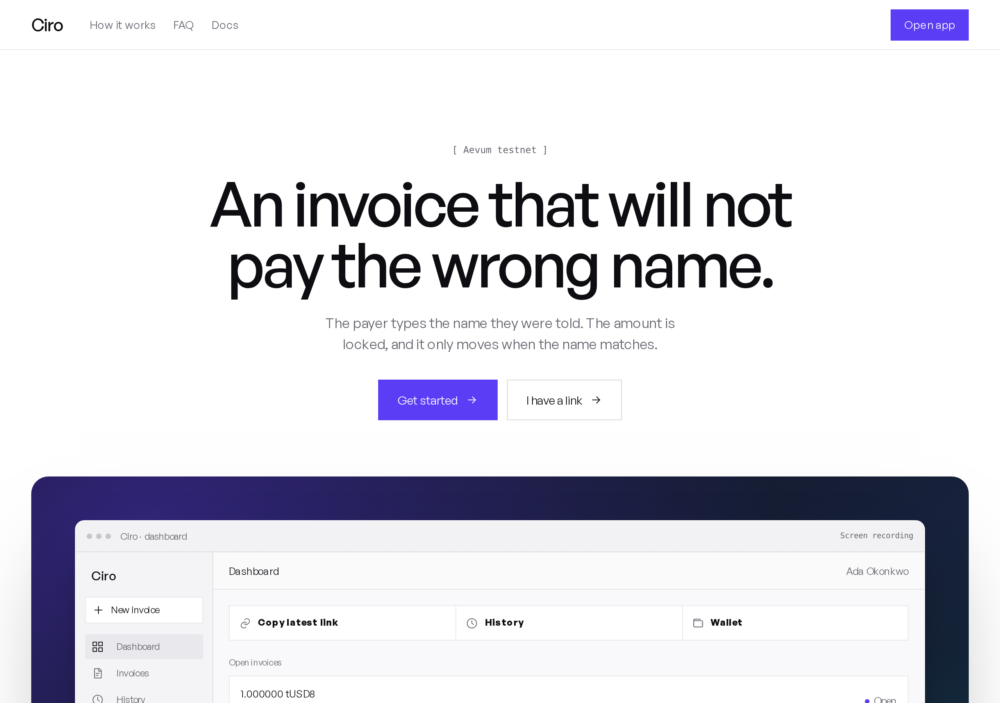
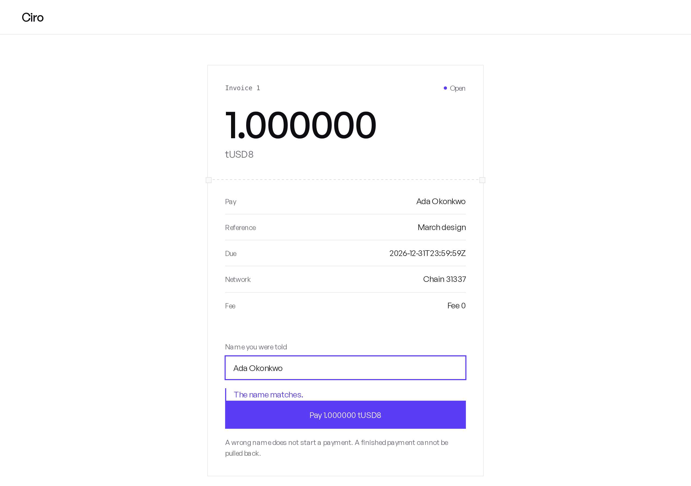
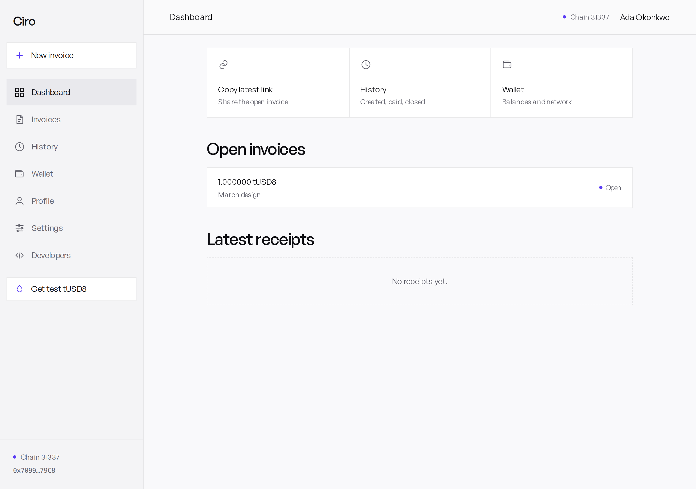
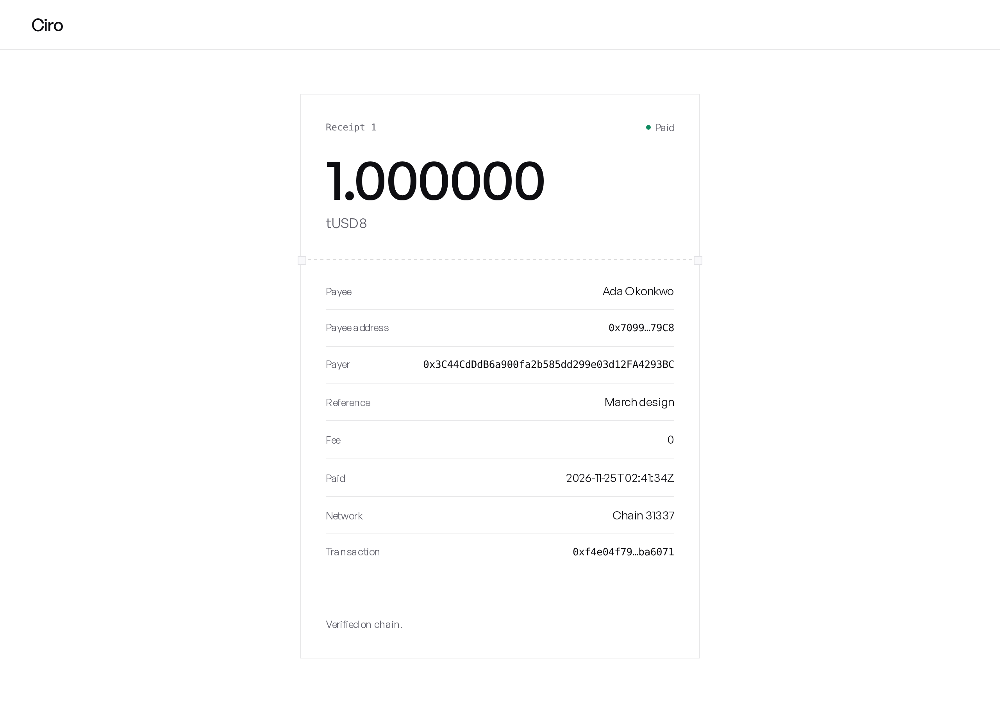

<div align="center">



# Ciro

**A stablecoin invoice that will not pay the wrong name.**

The amount is locked by the invoice. The payer's only decision is the name they were told.
The contract settles only when that name matches the name registered when the invoice was created.
A close name or an unknown name shows no pay button and moves no funds.

[ciro-a9s.pages.dev](https://ciro-a9s.pages.dev) · [GitHub](https://github.com/solutiono1/ciro)

Live on QDay Aevum testnet (chain 44005) · Ciro `0x4AceB37ecAce160B4363111460020c2d088C529C` · Fee 0

</div>

---

## The idea

A stablecoin transfer carries a sender, a receiver, and an amount. It does not carry the invoice, it does not check the name the payer was given, and it leaves no receipt an accountant can file. When the amount is short, the name is wrong, or the payment is late, a person repairs it by hand. The transfer is final.

Ciro makes the name the check. The payee registers a name and creates an invoice with a locked amount, a reference, a due time, and a network. The payer opens the link and types the name they were told. The contract compares the folded name to the snapshot on the invoice. Exact settles. Close and unknown do not.

The chain is the record. The API reads it and prepares unsigned transactions. Only the payer's wallet signs, or the CLI with a local key. Ciro never holds a key and never holds funds.

## How it works

1. **Register a name.** The payee publishes the name they want to be paid under. It is folded, so capitals and extra spaces still match.
2. **Create an invoice.** Amount, reference, and due time. The name, amount, due time, and network are locked on the invoice.
3. **Pay the name.** The payer opens the link, types the name, and signs. The contract settles only on an exact match.
4. **Keep the receipt.** Amount, payer, payee name, network, transaction hash, and time. The screenshot an accountant gets.

## Why a name

A wallet address is easy to copy wrong and hard to check. A registered name is something two people can agree on out loud. Ciro treats the name as the check, not as a label.

<div align="center">

</div>

| Result | What the payer sees | Button |
|---|---|---|
| Exact | The name matches the invoice | Pay the exact amount |
| Close | One letter or space off | No pay button |
| Unknown | Not the registered name | No pay button |

## Dashboard

The payee's dashboard is the invoices they can collect and the receipts that came back. There is no fake portfolio balance. The only balances live under Wallet, and they are the wallet's own tUSD8 and tQDAY.

<div align="center">

</div>

## Receipt

The receipt is the record. It carries the amount, the payer, the payee name, the reference, the network, and a link to the transaction on the explorer.

<div align="center">

</div>

## Build on it

The API, CLI, and MCP are built and wired. The SDK comes after the routes freeze. Every write returns an unsigned transaction; the caller signs.

<div align="center">

</div>

## Architecture

| Package | What it is |
|---|---|
| `contracts/` | `Ciro` (Solidity, Shanghai) holds payees, invoices, and allowances. `MockUSD8` is a local test token. |
| `packages/api` | HTTP API over `/v1`. Reads the chain and returns unsigned transactions. Holds no key. |
| `packages/cli` | The `ciro` binary. Signs locally with a key file and refuses a close name before it signs. |
| `packages/mcp` | An MCP server. Prepares payments; never signs. |
| `web/` | The web app. Vite and vanilla JS, built on the Maren Finance design system. |
| `packages/shared` | Name folding and money formatting, shared by the API and the tests. |

The chain is the source of truth. The API reads it and prepares calls; only a wallet or the CLI signs.

## API

| Method | Route | |
|---|---|---|
| GET | `/v1/meta` | chain, token, contract, fee |
| GET | `/v1/invoices/:id` | one invoice |
| POST | `/v1/invoices/:id/check` | compare a name to the invoice snapshot |
| GET | `/v1/receipts/:id` | one receipt |
| GET | `/v1/payees/:address` | registered name |
| GET | `/v1/payees/:address/invoices` | invoices by payee |
| GET | `/v1/payees/:address/allowances` | allowances by payee |
| GET | `/v1/payers/:address/receipts` | receipts by payer |
| POST | `/v1/check` | compare a name to the current registration |
| POST | `/v1/tx/register` | unsigned register |
| POST | `/v1/tx/invoice` | unsigned create |
| POST | `/v1/tx/pay` | unsigned pay |
| POST | `/v1/tx/pay-from-allowance` | unsigned allowance pay |
| POST | `/v1/tx/allow` | unsigned allowance |
| POST | `/v1/tx/revoke` | unsigned revoke |

Writes return `{ chainId, to, data, value, summary }` for the caller to sign. Errors are stable codes such as `name_mismatch`, `already_paid`, and `past_due`.

## CLI

```bash
ciro register "Ada Okonkwo"
ciro invoice --amount 100 --reference "March design" --due 2026-12-01
ciro check --payee 0x... --name "Ada Okonkwo"
ciro pay 4 --name "Ada Okonkwo"
ciro receipt 4
```

Config lives at `~/.ciro/config.json` or the path in `CIRO_CONFIG`. The key file is mode `0600` and is never printed. The CLI signs and broadcasts itself; the API never sees the key.

## MCP

The MCP server exposes the same reads and prepares a payment. It does not sign.

```bash
CIRO_API_URL=http://127.0.0.1:8787 node packages/mcp/bin/ciro-mcp.js
```

Tools: `ciro_check`, `ciro_prepare_invoice`, `ciro_prepare_pay`, `ciro_receipt`. A close or unknown name returns no transaction.

## Quickstart

```bash
npm install
cd contracts && forge test && cd ..
npm test
```

Run the web app and API locally:

```bash
npm run dev -w @getciro/web       # web app on Vite
npm start -w @getciro/api         # API; set CIRO_RPC_URL, CIRO_ADDRESS, CIRO_CHAIN_ID
```

## Tests

- `cd contracts && forge test` - 11 passed.
- `npm test` - shared, API, CLI, MCP, and web unit tests.
- `npm run e2e -w @getciro/web` - the pay flow and the public pages. A close name has no pay button; an exact name pays.

## On-chain proof

Ciro is deployed on QDay Aevum testnet at `0x4AceB37ecAce160B4363111460020c2d088C529C`, settling in tUSD8 (`0x456569838f1d43009A91ebA4263147Afd7233483`) with a zero fee.

| What | Transaction |
|---|---|
| Deploy | [`0x48cb3cd4`](https://explorer-test.qday.info/tx/0x48cb3cd4640ac251430de2f71fbcf8559236ab8cd3947c37c7ac5a872d0a8b6e) |
| Register "Ada Okonkwo" | [`0xe4bde111`](https://explorer-test.qday.info/tx/0xe4bde11146715b4f95bb7f5b8b79e9ffdfdb963310e8d18e990757ce64a99d05) |
| Create invoice 1 | [`0xddef8ca9`](https://explorer-test.qday.info/tx/0xddef8ca9ee32f55a3196a5c41457625ff8657c9a5101a2bbe294f70ff3b304de) |
| Exact name pays | [`0xfb5abc43`](https://explorer-test.qday.info/tx/0xfb5abc4355a35693fb25c3d8fa2516f31213ef276eed02bb28fdcb4c124bfe96) |
| Wrong name is refused | [`0xe4c01ead`](https://explorer-test.qday.info/tx/0xe4c01ead88c8c56632332222fa920d4f7823d09d45737e8f499cdd904a6554db) (reverted) |

## Security

- Non-custodial. The API and MCP never hold a key; only the wallet or the CLI signs.
- The contract enforces the exact amount, the exact name, and the due time.
- Allowances are capped and revocable, and a spender can only pay that payee's invoices.
- The in-app faucet is a local-test convenience. On Aevum, tUSD8 comes from the QDay faucet; if the site says not eligible, use the QDay Discord `#faucet` channel.

## License

MIT. See [LICENSE](LICENSE).
