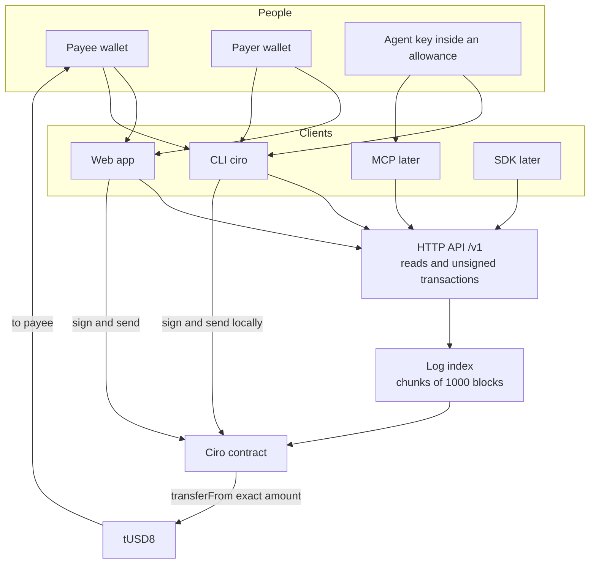

# Architecture

Ciro is a non-custodial invoice. The chain is the source of truth. The API reads the chain and prepares unsigned calls. The website, the CLI, and later the MCP server and the SDK all talk to that API. Nobody but the signer holds a key that can move funds.

## Diagram

Money never sits in the API. A signature happens in the wallet or in the CLI's local key. MCP and the SDK, which are published, only prepare. They do not hold a paying key.

The web app may also read the chain directly for the invoice on screen. Lists, history, and other clients go through the API so there is one read model.

## Contract

One contract, `Ciro`, Solidity, EVM version Shanghai. Cancun opcodes are a known way to deploy a contract that then reverts on Aevum.

State:

- **Payee.** `address => { nameHash, initials, display name, active }`. `nameHash` is the hash of the normalized name. Initials and length support a close match. The display name is public: the PRD requires the payer to see the registered name.
- **Invoice.** id, payee, amount (6 decimals), reference, network id, due time, payer, paid time. Paid when paid time is set. The Solidity field is `memo`. `reference` is a reserved word and will not compile. The API and the CLI still call it reference.
- **Allowance.** owner, spender, remaining cap, expiry, revoked. Spending the allowance pays an invoice. It does not transfer to an arbitrary address.

Calls:

- `register(name)` by the payee.
- `create(amount, reference, due)` returns an id. The payee must be registered. Network id is the chain the contract is on.
- `check(payee, claimedName) view` returns exact, close, or none, against the payee's current registration.
- `checkInvoice(id, claimedName) view` returns the same three results against the name locked when that invoice was created. `pay` uses this snapshot. A later `register` does not rewrite an open invoice.
- `pay(id, claimedName)` by the payer. Pulls the exact tUSD8 amount from the payer to the payee. Reverts on close, none, already paid, or past due. Fee, if the deployment's fee is non-zero, is a cut of that transfer to a fee recipient. The payer sees it before signing because the API puts it in the summary.
- `allow(spender, cap, expiry)` and `revoke(spender)` by the payee.
- `payFromAllowance(id, claimedName)` by the spender. Same checks, plus cap and expiry. Decrements the cap.

Normalization is one function, used on chain and copied in the API tests: trim, lowercase ASCII, collapse internal space, drop characters that are not letters, digits, or spaces. Empty is a revert. Close means the initials match, the word count matches, the length differs by at most two, and the hash does not match. Close never pays.

Events are the receipt: `Registered`, `InvoiceCreated`, `Paid`, `AllowanceSet`, `AllowanceRevoked`, and a refused attempt does not emit because it reverts. The revoked-allowance revert is `AllowanceIsRevoked`. The event keeps the name `AllowanceRevoked`. Solidity cannot use one identifier for both.

tUSD8 is the token address, set at deploy, immutable. Decimals are 6. The contract does not assume permit or EIP-3009 in v1. The payer approves the exact amount, then pays. Gasless EIP-3009 is a later path if we run a relayer. We do not run one in v1.

## API

HTTP, JSON. No API key for public reads of an invoice. Creating an invoice and registering a name return an unsigned transaction the caller signs. The API does not broadcast unless the CLI asks it to, and even then the CLI holds the key locally and broadcasts itself. The invoice API never sees a private key. A separate `/v1/faucet` endpoint holds a dedicated testnet-only treasury key to send fixed faucet amounts; it is not part of the invoice API.

The route list, the units, and the error codes are in `docs/architecture/INTEGRATIONS.md`. Base path `/v1`.

`GET /v1/payees/:address` returns whether a name is registered and, when it is, the display name. An earlier sentence said the API hides the name. That contradicted the PRD and the decision of 2026-11-21. The name is returned.

Writes return `{ chainId, to, data, value, summary }` for the wallet or the CLI to sign. A close or unknown name on pay returns `name_mismatch` and no `data`. The API does not mark an invoice paid.

There is no separate indexer process and no database. A receipt looks up the `Paid` log in chunks of at most 1,000 blocks. That limit is an Aevum behavior, recorded in the hackathon notes.

## Web app

A small web client. It adds chain 44005 if the wallet is elsewhere. It does not embed a custody wallet. Screens are specified in UX.md.

## CLI

`ciro` talks to the API and, when a local key is configured, signs and sends. Config is a file the user owns, mode 0600, not a server. Commands match the flow: `register`, `invoice`, `check`, `pay`, `receipt`, `allow`, `revoke`.

## What is deliberately absent

- A database of balances. The chain balance is the balance.
- A relayer, a bundler, a paymaster.
- A second service that can mark an invoice paid. Only `pay` can.
- Custody of user funds. The only key is the separate testnet faucet treasury; it cannot sign an invoice or move user funds.

## Deploy

One deployment on Aevum testnet for the contest. The address, deploy transaction, and proof transactions are in the README. Fee recipient is set, fee is zero. The source is verified on the Aevum explorer.
