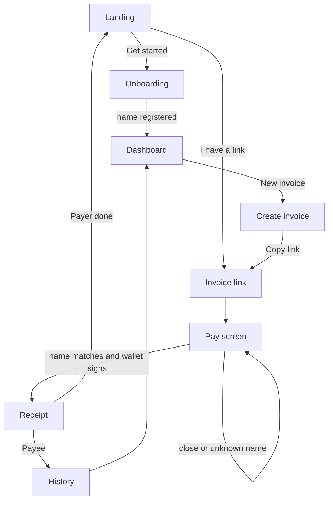
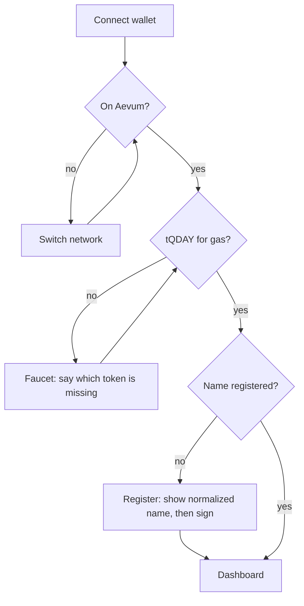
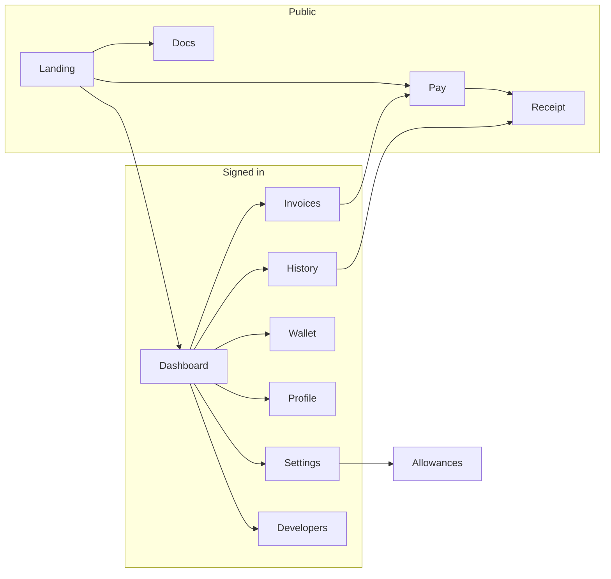

# UX

Reference: Maren Finance, https://www.marenfinance.xyz/ and the app screens described there (borrow, home, send by @handle). We follow the information design. We do not copy their files, their sentences, or their images.

## What we take from Maren

- One job on a screen. The home screen is not a dashboard of every future feature.
- The amount is the largest type on a pay screen.
- The recipient is resolved before the button exists. Maren resolves `@handle` to an address. We resolve the invoice to a name, an amount, a network, and a due time.
- Status is a few short lines, not a badge cloud: non-custodial, fee, network, what the contract will refuse.
- Risk and limits are written in plain sentences on the page where the person decides. Maren states liquidation and the pooled trove in the FAQ. We state that a wrong name cannot be undone because the payment never starts, and that a finished payment cannot be pulled back.
- Recent activity is a short list of receipts, each opening to one receipt.

## What we change

Maren asks the sender to type an amount and a handle. The sender can still pay the wrong person if the handle resolves to a surprising address. Ciro's payer does not type the amount. The invoice locks it. The payer's only decision is the name.

The pay screen has three visible results before any signature:

| Result | What the payer sees | Button |
|---|---|---|
| Exact | The name matches the account on this invoice. | Pay the exact amount. |
| Close | The name is almost the registered one. The payment will revert. | No pay button. Edit the name. |
| None | This name is not the account. | No pay button. |

The button is absent until the result is exact. A disabled button that still looks like pay is how people lose money.

Other designed states, each a screen and not only a toast:

- Empty: no invoices yet, one action, create one.
- Late: the due time has passed. The receipt says unpaid and closed.
- Already paid: the receipt, not a second pay button.
- Wrong network: the wallet is not on the invoice's chain. One action, switch to that chain.
- Faucet-poor: the payer lacks tUSD8 or tQDAY. Say which, and link the faucet. Do not say "transaction failed."

## Journey

Two people, one invoice. The payee has an account. The payer can arrive from a link and leave after the receipt. They do not need a profile.

A payer who only opens a link skips registration. Their onboarding is connect, correct network, enough tUSD8 and tQDAY, then the pay screen.

## Map

Landing is public. Everything under the dashboard needs a connected wallet. Pay and receipt are public so a client can open a link.

## Sections

**Landing.** One sentence: an invoice that will not pay the wrong name. The hero is an asymmetric split: the sentence and two actions on the left, a live name-check card on the right that types the name, shows the match, and reveals the pay button. Below it, a full-width app preview framed like a window. The preview is a placeholder for a real Ciro screen recording; replace the block inside `.stage` when the recording exists and keep the frame.

Then three steps, each with a line icon from the app's own set: register a name, send the invoice, the payer confirms the name. Then a photo-led split on why the name is the check, with the exact, close, and unknown rules. Then an FAQ, a docs teaser, and an invoice lookup by link or number. The header carries How it works, Docs, and a Get started button. The footer is the product, docs, and network columns with the demo line.

The landing may use photos and 3D icons because it is public marketing. The app screens stay flat: no photos, no illustration, no gradient. No feature grid for cards, yield, or payroll.

**Docs.** Public at `#/docs`. One page with a sticky section index: overview, API, CLI, MCP, contract, network. The API table lists every route. The contract and token addresses link to the explorer when `/v1/meta` answers. Two actions: add Aevum to the wallet, and get 1,000 tUSD8 from the test faucet. The docs link to the app and to `/v1/meta`, and the page never asks for a key.

**Onboarding.** The diagram above. The normalized name is shown before the signature, so extra spaces and capitals are obviously the same name.

**Dashboard.** Open invoices first, then a short list of the latest receipts. Two actions: new invoice, copy the last unpaid link. The registered name sits in the corner, not as a hero number. There is no fake portfolio balance. The only balances live under Wallet, and they are the wallet's own tUSD8 and tQDAY.

**Invoices.** List of open, late, and paid. Create: amount, reference, due. Network is shown and fixed to Aevum in v1. Detail: status, link, copy. Late invoices stay in the list as closed, not as a pay button.

**Pay.** The screen in the table above. Amount, fee line, network, and due time are read-only. The name field is the only input. Exact shows Pay. Close and none do not. If the wallet is on another chain, the app switches or adds the Ciro chain before the signature, so the wallet never quotes mainnet gas for a testnet invoice. If the wallet lacks tUSD8, the same screen offers the test faucet and mints 1,000 tUSD8 without leaving Ciro.

**Receipt.** Amount, payee name, payer address, reference, time, explorer link. This is the screenshot an accountant gets. From history it is the same screen.

**History.** Created, paid, and closed invoices for this wallet, as payee or as payer. A refused name never happened on chain, so it is not a history row. The pay screen already showed it.

**Wallet.** Connected address, network, tUSD8 balance, tQDAY balance, switch network, disconnect. Copy address. Get test tUSD8 mints 1,000 from the test token. Add network calls `wallet_addEthereumChain` with the chain parameters from `/v1/meta`, so a wallet that has never seen Aevum gets it in one step. If either balance is too low to create or to pay, say which and link the faucet. This is not a custodial account and it does not hold a second balance inside Ciro.

**Profile.** The registered name, the address it is bound to, and change name. Changing name signs `register` again. Open invoices keep the name that was registered at payment time on the receipt. Say that before they sign the change.

**Settings.** Allowances: spender, cap, expiry, revoke, in the sentence from the allowance screen. Fee: zero on this deployment, and the 0.5% rule for a later priced deployment, written once. Nothing else. No notification preferences until there is something to notify.

**Developers.** Inside the dashboard, for the payee who wants to integrate. Contest build: the deployment addresses, the network, the fee, an add-network action, a link to the docs, the API base URL, and the CLI commands that match the buttons. MCP and the SDK are listed as next, not as live buttons, until those ships exist. No API key in v1. Reads of an invoice are public. Writes return an unsigned transaction.

## Not in v1

Cards, bank cash-out, yield, payroll, a second currency balance, chat, and a team admin. Those are the products this build leaves out. Putting them in the navigation would be a menu of things we do not do.

## Screens, listed

1. Landing.
2. Docs.
3. Onboarding: connect, network, faucet, register.
4. Dashboard.
5. Invoices: list, create, detail.
6. Pay.
7. Receipt.
8. History.
9. Wallet.
10. Profile.
11. Settings, including allowances.
12. Developers.

## Motion

One easing curve, `cubic-bezier(0.2, 0.7, 0.2, 1)`, on every transition. Motion answers an action: a hover lifts a row, a link underlines from the left, a section fades in once, the hero name types itself. Nothing loops as decoration. The only loop is the text caret, which stops when the name matches. Every animation has a `prefers-reduced-motion` branch that renders the final state.

## Images

The landing uses one CC0 photo from StockSnap in `web/public/img/`: `paperwork-desk.jpg` by Matt Moloney, credited under it. Every icon on the landing is a line icon from the app's own set, one stroke and one size. The three 3D files in `web/public/icons/` are no longer used. The app screens use no photos.

The landing's app preview (`.stage`) is a drawn stand-in for a real dashboard recording. The page does not play a video until one exists. The earlier `web/public/media/ciro-demo.webm` recorded the landing page itself, so the preview showed Ciro inside Ciro; the element was removed rather than shipped. `scripts/record-demo.mjs` records a click-through to that file. When a real dashboard pass exists, wire it back into `.stage` over the drawn preview, muted, looped, with `prefers-reduced-motion` keeping the still. The recording must be real app footage with mock data and a scripted cursor, not an AI-generated image.

The `[ bracket ]` labels stay as the section signature, in sentence case with no wide tracking. Display tracking is tight; small text and body text are not.

## Writing

Short sentences. Name the thing that happens. Do not say "seamless", "empower", or "the future of payments." If a rule will cost someone money, put it on the screen where they sign.

## Make it better than the reference

Maren's send screen is the right shape and the wrong last question. Their last question is "which handle?" Ours is "is this the name you were told?" The rest of the chrome stays as quiet as theirs: one column, large amount, one primary action, a list under it.

## Fonts

The target voice is Neue Montreal, the family Maren uses. `styles.css` declares each file with `@font-face`. These names are fixed; other agents must not rename the files:

| File | Family | Weight |
|---|---|---|
| `NeueMontreal-Light.woff2` | neueMontreal | 300 |
| `NeueMontreal-Regular.woff2` | neueMontreal | 400 |
| `NeueMontreal-Medium.woff2` | neueMontreal | 500 |
| `NeueMontreal-Bold.woff2` | neueMontreal | 700 |
| `SFProRounded-Regular.woff2` | SF Pro Rounded | 400 |
| `SF-Pro-Rounded-Black.otf` | SF Pro Rounded | 900 |

The Neue Montreal files and `SFProRounded-Regular.woff2` are commercial or restricted (Pangram Pangram and Apple), so they are not in the repo. Until the owner drops the licensed files into `web/public/fonts/` with these exact names, the app loads **General Sans** from Fontshare (ITF Free Font License), self-hosted at `web/public/fonts/GeneralSans-*.woff2`. It sits after `neueMontreal` in `--sans`, so the real files win automatically when they arrive. Do not rename the files or edit the `@font-face` block when they arrive.

Display and headings use weight 500, body and buttons 400, matching Maren's tokens. The stack is `"neueMontreal", "SF Pro Rounded", -apple-system, BlinkMacSystemFont, "Segoe UI", Roboto, sans-serif`.

License: Neue Montreal is from Pangram Pangram (free to try, licenses from $40). SF Pro Rounded is Apple's, licensed only for building apps for Apple platforms, so embedding it on the web is outside that license. Keep it out of the public build unless the owner clears it.
